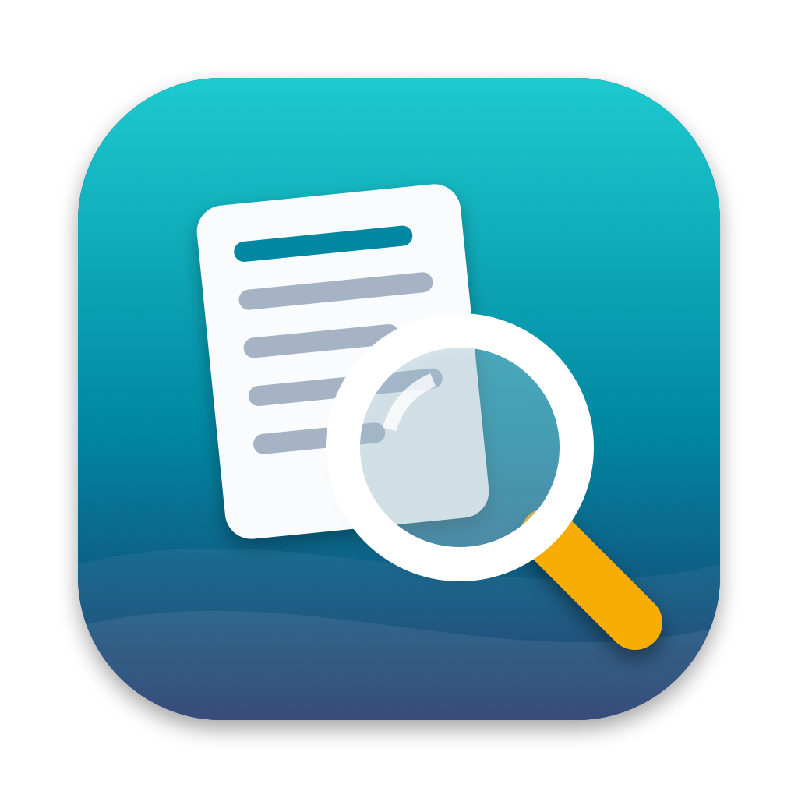

<p align="center">
  
</p>

<h1 align="center">Trawl</h1>

<p align="center">Fast file search for Apple Silicon Macs that combines Spotlight's index with a live folder scan.</p>

Trawl searches file names and file contents with Boolean queries, wildcards, and regular
expressions. Spotlight answers instantly from its index (including text inside PDF, Word,
Excel, and PowerPoint files), while a folder scan reads the disk directly to cover what the
index misses: hidden folders, unindexed locations, and files not indexed yet. Results from
both are merged into one list.

It is a native SwiftUI app with no third-party dependencies, inspired by EasyFind.

## Features

- **Two search engines, one result list.** Spotlight and a live folder scan run together;
  each result shows which engine found it. Either engine can also be used on its own.
- **Names, contents, or both.** Content search covers plain-text files directly, and PDF and
  Office documents through Spotlight.
- **Boolean queries** with `AND`, `OR`, `NOT`, quoted phrases, parentheses, and `*` / `?`
  wildcards, or a regular-expression mode.
- **File-type filters.** Limit a search to Word, Excel, PowerPoint, PDF, Text, Markdown,
  HTML, Log, Images, Video, Audio, or Archives, or use the Common Files preset.
- **Quick filters** above the results: one icon per file type with counts; click to narrow
  the current results without searching again.
- **Folder scoping.** Search several folders at once, or select one in the sidebar to show
  and search only that folder.
- **Results table** sortable by name, folder, size, date, and kind. Open, reveal in Finder,
  copy path, move to Trash, or drag files into other apps.
- **Clear about blocked folders.** Folders macOS will not let Trawl read are listed in the
  status bar, with a shortcut to the privacy settings that unlock them.

## Requirements

- Mac with Apple Silicon, macOS 14 Sonoma or later
- Xcode 15.3 or later (Swift 5.10 toolchain) to build; developed with Xcode 26
- Spotlight indexing turned on, for the Spotlight engine (the folder scan works without it)

## Build and run

```bash
./scripts/build-app.sh
open build/Trawl.app
```

`build-app.sh` builds a release binary, wraps it in `build/Trawl.app`, and signs it with the
first "Apple Development" certificate in your keychain. A stable signature lets macOS
remember the folder permissions you grant across rebuilds. Without a certificate the app is
signed ad hoc, and permissions must be granted again after each build. To choose the
identity yourself:

```bash
TRAWL_SIGN_IDENTITY="Apple Development: you@example.com (TEAMID)" ./scripts/build-app.sh
```

For development:

```bash
swift run Trawl      # run without building the .app bundle
swift test           # run the unit tests
```

## Usage

Type a query and press Return. Choose **Names**, **Contents**, or **Names & Contents** in
the toolbar; pick file types from the Types menu; set the engine and matching options in the
Options menu.

### Query syntax

| Query                           | Finds                                              |
|---------------------------------|----------------------------------------------------|
| `report budget`                 | both words (implicit AND)                          |
| `report AND budget`, `&`        | same                                               |
| `report OR memo`, `\|`          | either word                                        |
| `NOT draft`, `-draft`, `!draft` | excludes a word                                    |
| `"annual report"`               | exact phrase                                       |
| `(a OR b) c`                    | grouping                                           |
| `*.pdf`, `img_??.png`           | wildcards: `*` any characters, `?` one character   |

Operators must be upper case; `and`, `or`, and `not` in lower case are searched as words.
A wildcard term must match the whole file name (`*.pdf` finds names ending in `.pdf`) but
can match anywhere in file contents.

### Search engines

| Engine                     | Speed                     | Covers                                                          |
|----------------------------|---------------------------|-----------------------------------------------------------------|
| Spotlight + Folder Scan    | first results in < 1 s    | everything below, merged (default)                              |
| Folder Scan Only           | seconds to minutes        | every readable file, including hidden and unindexed folders     |
| Spotlight Only             | < 1 s                     | indexed files, including text inside PDF and Office documents   |

Spotlight matches content by word and word prefix, and is not used for regex queries or for
content searches that contain `NOT`; the folder scan handles those.

## Permissions

macOS protects Desktop, Documents, Downloads, removable drives, and some other locations.
The first time Trawl searches one of them, macOS asks for access. Spotlight also hides
results in protected folders an app may not read, so allow access when asked. Folders that
stay blocked appear in the status bar; to search everything, add Trawl under
**System Settings → Privacy & Security → Full Disk Access**.

## How it works

```
TrawlCore (library)
├── QueryParser, Matcher     Boolean query → expression tree; exact name/text matching
├── FileSearcher             folder scan, contents checked in parallel → result stream
├── SpotlightQueryBuilder    query → Spotlight query (NOT is re-checked locally)
├── SpotlightSearcher        NSMetadataQuery over the chosen folders → path stream
└── HybridSearcher           runs both engines, verifies Spotlight hits, merges by path

Trawl (SwiftUI app)
└── SearchModel, ContentView, ResultsTable, FileTypeViews
```

Every Spotlight hit is checked before it is shown: it must still exist, lie inside a chosen
folder, pass the type and visibility options, and, for name searches, match the query
exactly. See [SPEC.md](SPEC.md) for the full design.

## Project layout

```
Sources/TrawlCore/     search engine (unit-tested)
Sources/Trawl/         SwiftUI app
Tests/TrawlCoreTests/  unit tests
Assets/                app icon (.icns and source .png)
scripts/               build-app.sh, make-icon.sh, draw-icon.swift
SPEC.md                design notes
```

The icon is drawn in code: `./scripts/make-icon.sh` regenerates `Assets/AppIcon.icns` from
`scripts/draw-icon.swift`.

## Limitations

- Text inside PDF and Office files is only found through Spotlight, so it requires an
  up-to-date index of those folders.
- Spotlight matches content by word prefix: a keyword in the middle of a word is found only
  by the folder scan, which reads plain-text files.
- The app is not notarized and is intended for personal use; distributing it to other Macs
  requires a Developer ID certificate and notarization.
